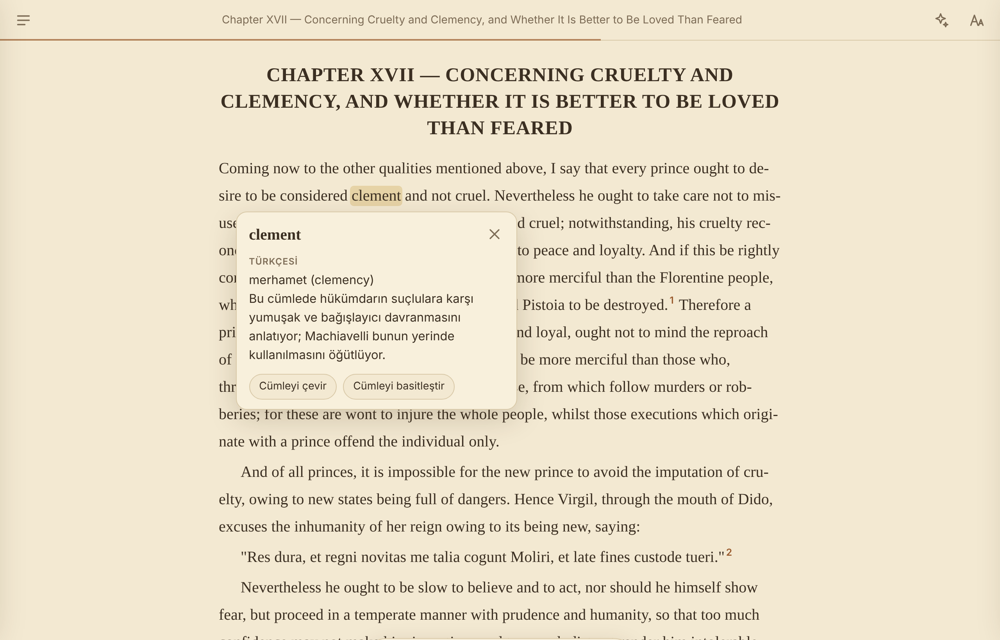
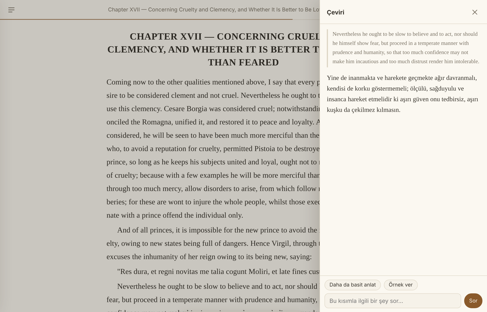
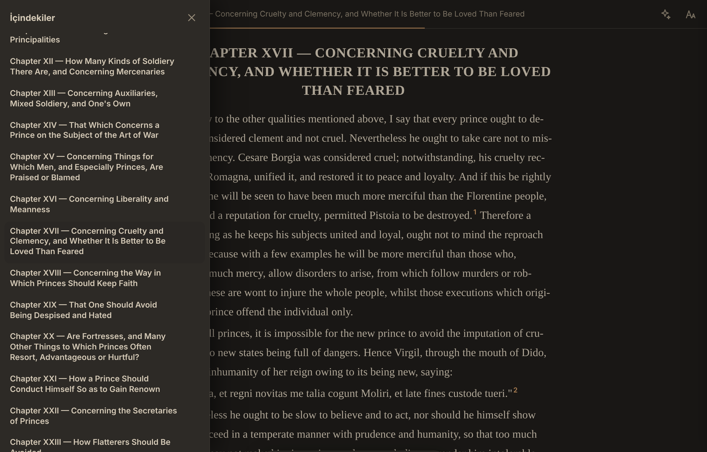
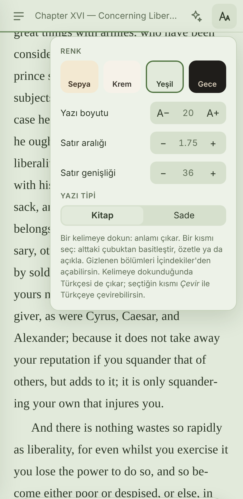

<p align="center"></p>

<h1 align="center">Reading Room</h1>

<p align="center">A Claude skill that turns a book or long text into an interactive reading page:<br>glossary, footnotes, contents, themes, and AI help to simplify, summarize, explain and translate.</p>

<p align="center"><a href="README.tr.md">Türkçe</a> · <a href="#install">Install</a> · <a href="examples/the-prince">Example</a> · <a href="CHANGELOG.md">Changelog</a></p>

---



## What it does

Give Claude a PDF, EPUB, DOCX, Markdown or plain-text book and ask for a reading room. The skill extracts the text, writes a glossary of the book's difficult terms, and builds a single HTML page you can read in any browser. On claude.ai it is published as an artifact, so the AI features work right on the page.

**On the page**

- **Tap a word** to see its glossary definition and, with AI, what it means in that sentence.
- **Select a passage** and choose *Simplify*, *Summarize* or *Explain*. The answer streams into a side panel where you can ask follow-up questions, ask for an even simpler version or an example.
- **Translate** (when the book's language differs from the interface language): tapping a word gives its equivalent in context, and *Translate* renders a selected passage into the interface language.
- **Summarize where I am**: one button for a summary of the part you are reading.
- **Footnotes** open in place.
- **Contents** with chapter hiding: tuck away a preface, appendices or bibliography; they stay one tap away. Jump to a printed page number (for PDFs).
- **Display settings**: four themes (sepia, cream, green, night), text size, line spacing, line width, book or plain typeface.
- Your reading position, settings and hidden chapters are remembered in your browser.
- Interface in **Turkish or English**.

| Translation panel | Contents, night theme | Phone |
|---|---|---|
|  |  |  |

## Install

### claude.ai (web, desktop, mobile)

1. Download `reading-room-skill.zip` from the [latest release](../../releases/latest).
2. In Claude, open **Settings → Capabilities → Skills** (on some accounts **Customize → Skills**) and choose **Upload skill**.
3. Select the zip.

Skills need code execution to be enabled for your account.

### Claude Code

```text
/plugin marketplace add alperydn/reading-room
/plugin install reading-room@reading-room
```

Or copy `plugins/reading-room/skills/reading-room` into `~/.claude/skills/`.

## Use

Attach a book and ask, for example:

> Make a reading room from this PDF. Hide the preface and the bibliography by default. The reader is a first-year student.

> Turn this EPUB into a reading room with an English interface.

> Create a reading room for this English book with a Turkish interface, so I can translate words as I read.

Claude asks which file, which chapters to hide, and who the reader is, if you have not said. The interface language follows the language you write in unless you ask otherwise.

### Where the AI features work

| Where | Glossary, footnotes, contents, themes | AI: simplify, summarize, explain, translate |
|---|---|---|
| claude.ai artifact | ✓ | ✓ (asks for your consent the first time) |
| HTML file opened in a browser (Claude Code, API) | ✓ | — The buttons offer to copy the text, and translation links to Google Translate |

## How it works

```
book.pdf ──► scripts/pdf_to_json.py ─┐
book.epub ─► scripts/text_to_json.py ┴─► data.json ─┐
                         Claude writes ─► gloss.json ├─► scripts/build_page.py ─► page.html
                         Claude writes ─► config.json┘        (fills assets/sablon.html)
```

- **`pdf_to_json.py`** detects printed page numbers, strips running headers and footers, joins hyphenated words, keeps italics and bold, separates footnotes and finds chapter headings. It prints a report so Claude can correct the page offset or supply chapters by hand.
- **`text_to_json.py`** handles TXT, Markdown, and DOCX/EPUB through pandoc.
- **`build_page.py`** validates the data and fills the page template.

The skill's own instructions (`SKILL.md`) and the data schema are written in Turkish; Claude follows them in any language. The data format is described in [`references/veri-semasi.md`](plugins/reading-room/skills/reading-room/references/veri-semasi.md).

## Example

[`examples/the-prince`](examples/the-prince) contains a reading room built from Machiavelli's *The Prince* (W. K. Marriott's 1908 translation, public domain), with an English text, a Turkish interface and a 160-term glossary. Open [`the-prince-reading-room.html`](examples/the-prince/the-prince-reading-room.html) in a browser to try it without installing anything (AI features need claude.ai).

## Limits

- Scanned PDFs without a text layer need OCR first (for example `ocrmypdf`).
- PDF layout detection is heuristic. Unusual layouts (two columns, marginal notes) may need manual correction; the script's report and options help.
- Word matching in the glossary strips Turkish and English suffixes; other languages match exact forms.
- The interface is available in Turkish and English.

## Copyright

A reading room contains the full text of the book. Build one from a book you have the right to use, and do not share a page made from a copyrighted book publicly.

## Releasing

1. Update `version` in `plugins/reading-room/.claude-plugin/plugin.json` and in `SKILL.md`, and add an entry to `CHANGELOG.md`.
2. On GitHub, create a release with a new tag `vX.Y.Z`. You do not need to attach anything: a workflow packages `reading-room-skill.zip` and adds it to the release.

## License

[MIT](LICENSE)
