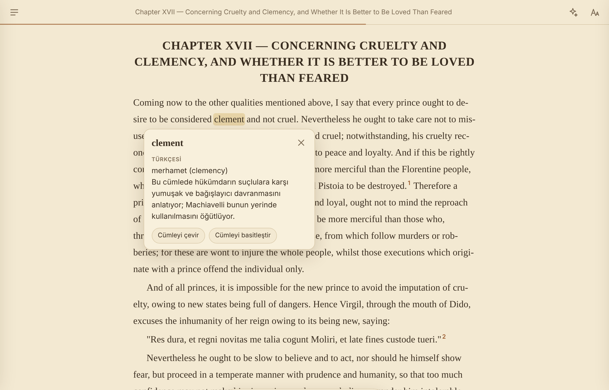
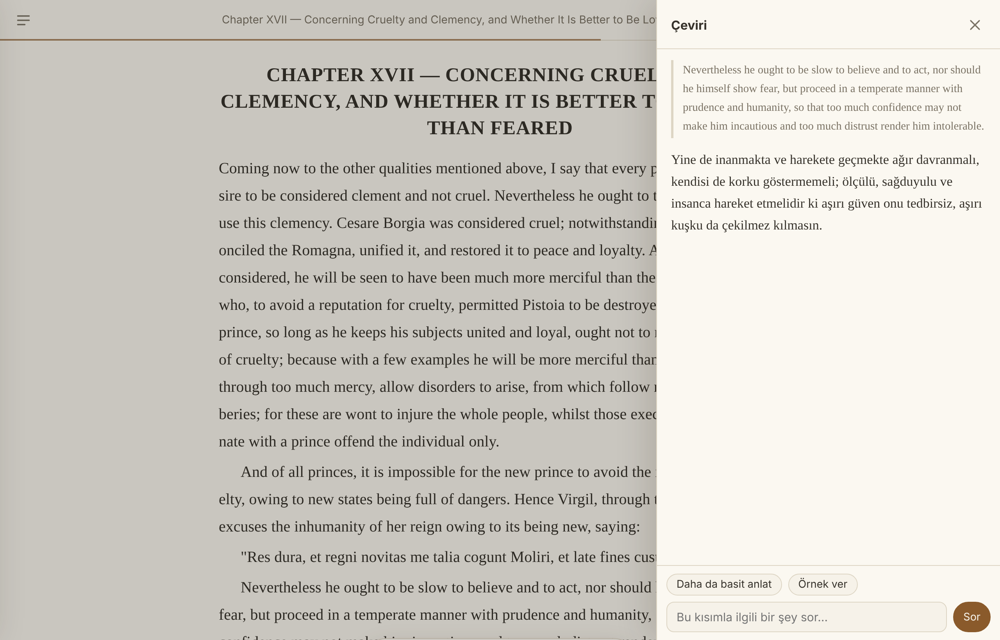
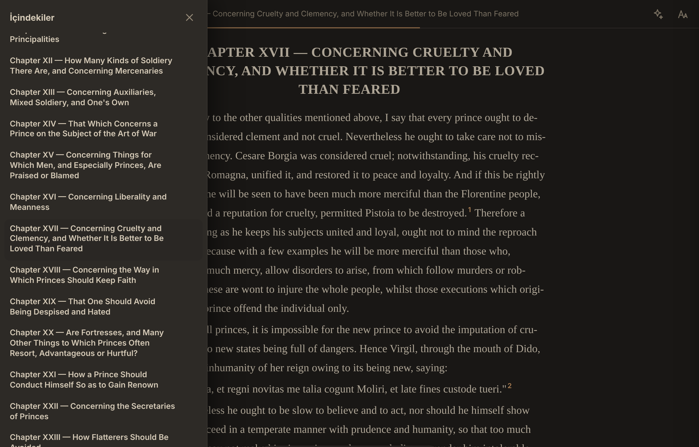
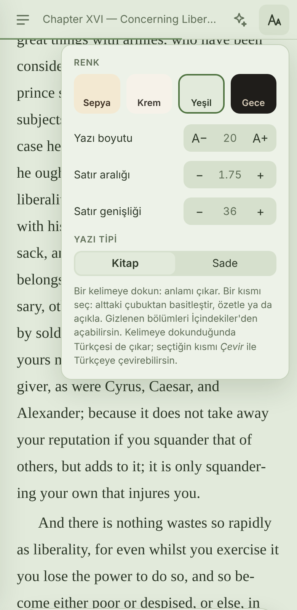

<p align="center"></p>

<h1 align="center">Reading Room</h1>

<p align="center">Bir kitabı ya da uzun bir metni etkileşimli bir okuma sayfasına çeviren Claude skill'i:<br>sözlük, dipnotlar, içindekiler, temalar ve yapay zekâ ile basitleştirme, özetleme, açıklama ve çeviri.</p>

<p align="center"><a href="README.md">English</a> · <a href="#kurulum">Kurulum</a> · <a href="examples/the-prince">Örnek</a> · <a href="CHANGELOG.md">Sürüm geçmişi</a></p>

---



## Ne yapar?

Claude'a bir PDF, EPUB, DOCX, Markdown ya da düz metin kitap verip okuma odası isteyin. Skill metni çıkarır, kitabın zor terimlerinden bir sözlük yazar ve herhangi bir tarayıcıda okunabilen tek bir HTML sayfası üretir. claude.ai'de sayfa artifact olarak yayınlanır; yapay zekâ özellikleri doğrudan sayfanın içinde çalışır.

**Sayfada neler var?**

- **Kelimeye dokunun:** Sözlük tanımı ve yapay zekâ ile o cümledeki anlamı çıkar.
- **Bir kısmı seçin:** *Basitleştir*, *Özetle* ya da *Açıkla*. Cevap yan panelde yazılarak gelir; ardından soru sorabilir, "Daha da basit anlat" ya da "Örnek ver" diyebilirsiniz.
- **Çeviri** (kitabın dili arayüz dilinden farklıysa): Kelimeye dokununca bağlamdaki karşılığı gelir; seçtiğiniz kısmı *Çevir* ile arayüz diline çevirebilirsiniz.
- **Bulunduğum yeri özetle:** Okuduğunuz kısmın özeti tek düğmede.
- **Dipnotlar** yerinde açılır.
- **İçindekiler** ve bölüm gizleme: önsöz, ekler ya da kaynakça gibi bölümleri gizleyin; İçindekiler'den tek dokunuşla açılır. PDF'lerde basılı sayfa numarasına gidilebilir.
- **Görünüm:** dört tema (Sepya, Krem, Yeşil, Gece), yazı boyutu, satır aralığı, satır genişliği, Kitap ya da Sade yazı tipi.
- Okuma konumu, ayarlar ve gizli bölümler tarayıcınızda hatırlanır.
- Arayüz **Türkçe ya da İngilizce**.

| Çeviri paneli | İçindekiler, Gece teması | Telefon |
|---|---|---|
|  |  |  |

## Kurulum

### claude.ai (web, masaüstü, mobil)

1. [Son sürümden](../../releases/latest) `reading-room-skill.zip` dosyasını indirin.
2. Claude'da **Ayarlar → Yetenekler → Skills** (bazı hesaplarda **Özelleştirme → Skills**) sayfasını açıp **Skill ekle / Upload skill**'i seçin.
3. Zip dosyasını seçin.

Skill'lerin çalışması için hesabınızda kod çalıştırmanın açık olması gerekir.

### Claude Code

```text
/plugin marketplace add alperydn/reading-room
/plugin install reading-room@reading-room
```

Ya da `plugins/reading-room/skills/reading-room` klasörünü `~/.claude/skills/` içine kopyalayın.

## Kullanım

Bir kitap ekleyip örneğin şöyle isteyin:

> Bu PDF'ten bir okuma odası yap. Önsözü ve kaynakçayı varsayılan olarak gizle. Okur birinci sınıf öğrencisi.

> Bu EPUB'u İngilizce arayüzlü bir okuma odasına çevir.

> Bu İngilizce kitap için Türkçe arayüzlü bir okuma odası kur; okurken kelimeleri çevirebileyim.

Belirtmediyseniz Claude hangi dosyayı, hangi bölümlerin gizleneceğini ve okurun kim olduğunu sorar. Arayüz dili, aksini söylemezseniz Claude'la yazıştığınız dil olur.

### Yapay zekâ özellikleri nerede çalışır?

| Nerede | Sözlük, dipnot, içindekiler, temalar | Yapay zekâ: basitleştir, özetle, açıkla, çevir |
|---|---|---|
| claude.ai artifact'i | ✓ | ✓ (ilk kullanımda izin ister) |
| Tarayıcıda açılan HTML dosyası (Claude Code, API) | ✓ | — Düğmeler metni kopyalamayı önerir; çeviri için Google Çeviri bağlantısı çıkar |

## Nasıl çalışır?

```
kitap.pdf ──► scripts/pdf_to_json.py ─┐
kitap.epub ─► scripts/text_to_json.py ┴─► data.json ─┐
                         Claude yazar ─► gloss.json ├─► scripts/build_page.py ─► sayfa.html
                         Claude yazar ─► config.json┘      (assets/sablon.html'i doldurur)
```

- **`pdf_to_json.py`** basılı sayfa numaralarını bulur, üst ve alt bilgileri temizler, tirelenmiş kelimeleri birleştirir, italik ve kalını korur, dipnotları ayırır ve bölüm başlıklarını bulur. Sonunda bir rapor yazar; Claude sayfa kaymasını düzeltebilir ya da bölümleri elle verebilir.
- **`text_to_json.py`** TXT ve Markdown dosyalarını, pandoc ile de DOCX ve EPUB'u işler.
- **`build_page.py`** veriyi denetler ve sayfa şablonunu doldurur.

Veri biçimi [`references/veri-semasi.md`](plugins/reading-room/skills/reading-room/references/veri-semasi.md) dosyasında anlatılıyor.

## Örnek

[`examples/the-prince`](examples/the-prince) klasöründe Machiavelli'nin *The Prince*'inden (W. K. Marriott'un 1908 çevirisi, telifsiz) kurulmuş bir okuma odası var: İngilizce metin, Türkçe arayüz ve 160 terimlik sözlük. Hiçbir şey kurmadan denemek için [`the-prince-reading-room.html`](examples/the-prince/the-prince-reading-room.html) dosyasını tarayıcıda açın (yapay zekâ özellikleri için claude.ai gerekir).

## Sınırlar

- Metin katmanı olmayan taranmış PDF'ler için önce OCR gerekir (örneğin `ocrmypdf`).
- PDF düzeni sezgisel olarak çözülür. Alışılmadık düzenler (iki sütun, kenar notları) elle düzeltme isteyebilir; script'in raporu ve seçenekleri bunun için var.
- Sözlük eşleştirmesi Türkçe ve İngilizce ekleri ayıklar; diğer dillerde tam biçimler eşleşir.
- Arayüz Türkçe ve İngilizce.

## Telif

Bir okuma odası kitabın tam metnini içerir. Kullanma hakkınız olan bir kitaptan oluşturun; telifli bir kitaptan yaptığınız sayfayı herkese açık paylaşmayın.

## Lisans

[MIT](LICENSE)
